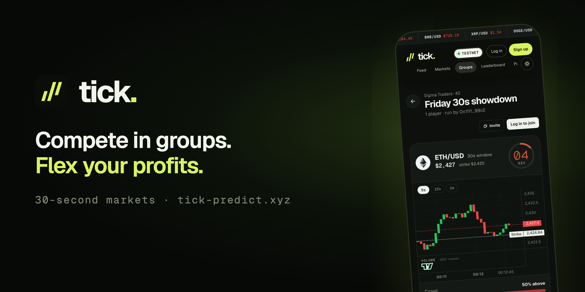
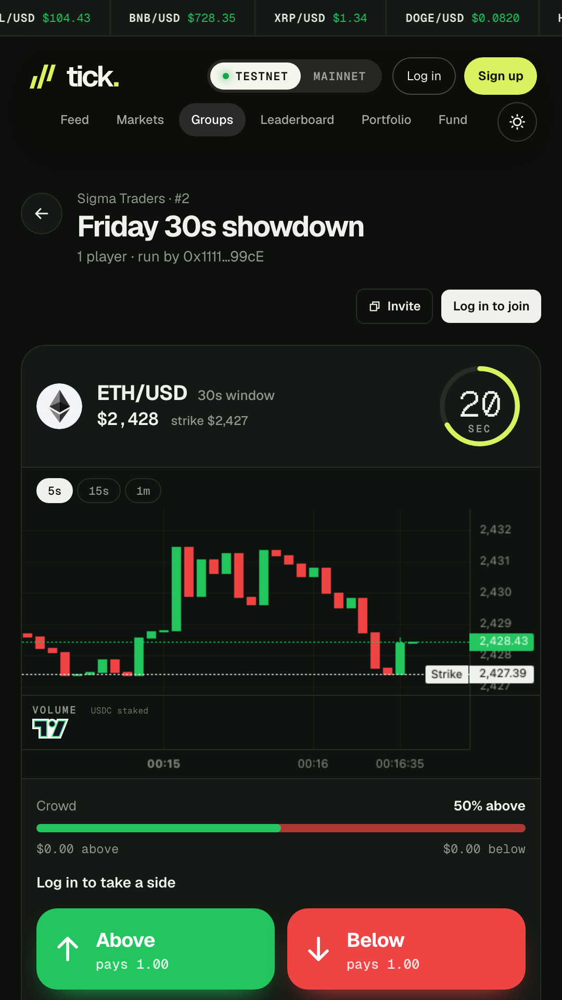
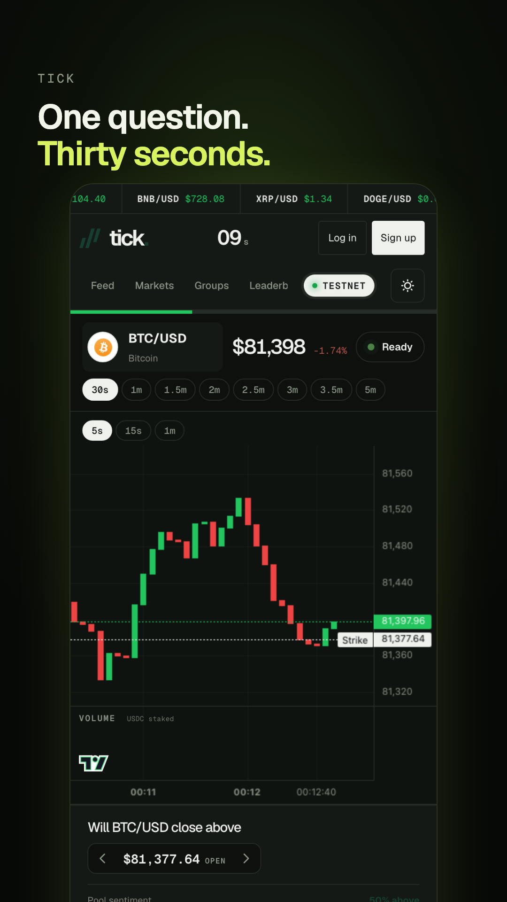
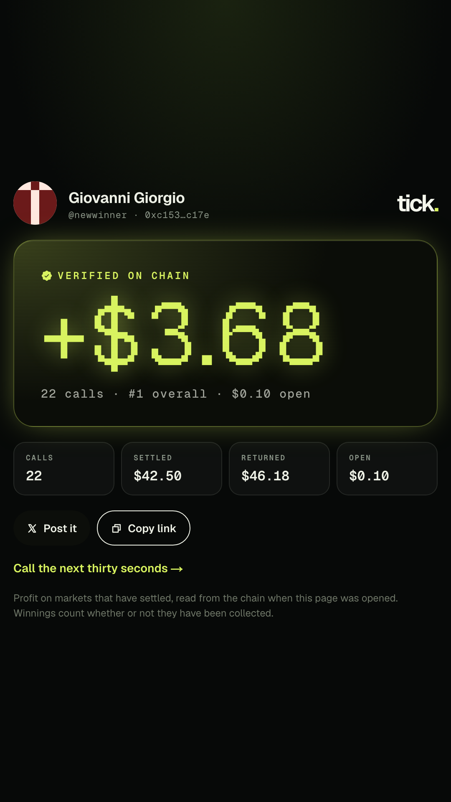
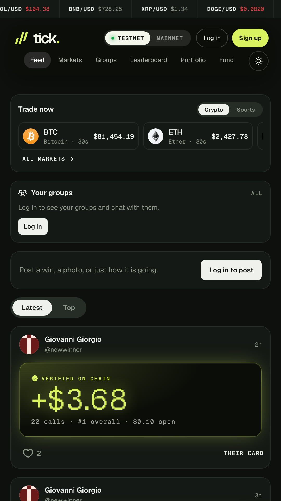
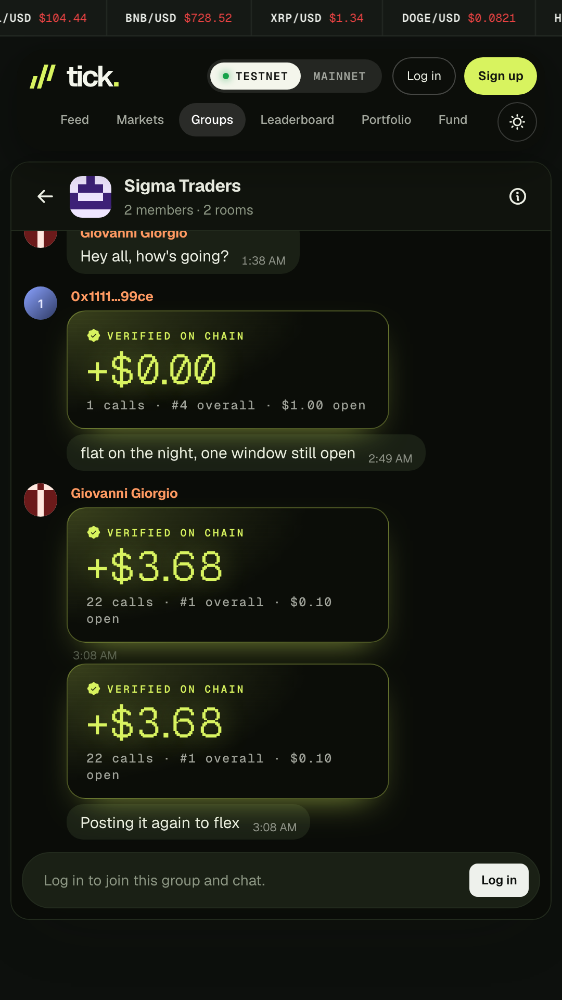
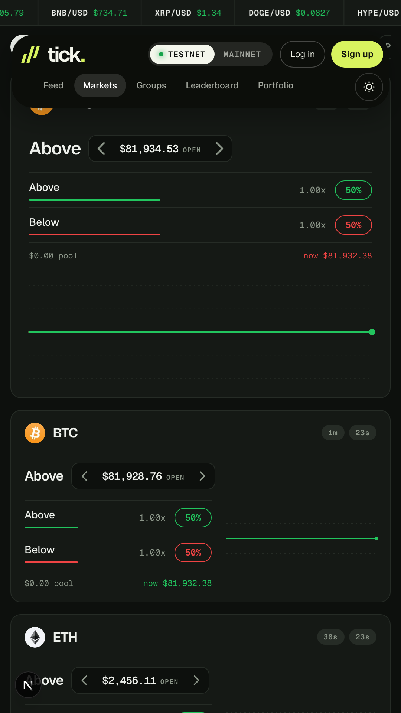
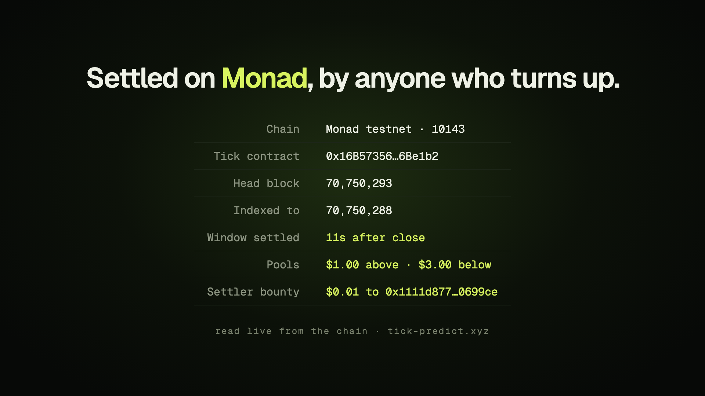

# Tick

**The world's first 30-second prediction market, played with your friends.**

Open a room inside your group, call the same thirty seconds as everyone else, race a scoreboard that
re-sorts after every window, and post a card drawn from your real on-chain record. Nobody can fake a
win and nobody can quietly hide a loss, because the number comes off the chain.

**Live:** [tick-predict.xyz](https://tick-predict.xyz) ·
**Android:** [direct download](https://github.com/Khalid-000-ME/tick/raw/main/mobile/dist/tick.apk)
([in-repo](mobile/dist/tick.apk), [release](https://github.com/Khalid-000-ME/tick/releases/tag/v1.0.0)) ·
**Chain:** Monad testnet, chain 10143

| | |
|---|---|
| Market | `0x16B57356a482Fc5b307bB76D7dC8F5d76A6Be1b2` |
| Status | live, 104 contract tests passing, Android build shipped |
| Solana | Anchor port written and proven on a local validator, devnet deploy pending |

---

## Contents

- [What it is](#what-it-is)
- [The screens](#the-screens)
- [Proof it is live on Monad](#proof-it-is-live-on-monad)
- [How the market works](#how-the-market-works)
- [Concurrency: what sharding actually buys](#concurrency-what-sharding-actually-buys)
- [The on-chain social layer](#the-on-chain-social-layer)
- [Application architecture](#application-architecture)
- [Envio: the whole read path](#envio-the-whole-read-path)
- [Privy: wallets, not just login](#privy-wallets-not-just-login)
- [Solana: the port, and exactly where it stands](#solana-the-port-and-exactly-where-it-stands)
- [Repository map](#repository-map)
- [Run it](#run-it)
- [Proven on chain](#proven-on-chain)
- [Limits worth knowing](#limits-worth-knowing)
- [Licence, tools and attribution](#licence-tools-and-attribution)

---

## What it is

- **Call a window.** Will this price be higher thirty seconds from now? Above or below, from ten
  cents. Crypto, equities and sport.
- **Compete in a group.** Make a group, open rooms inside it, pick the market everyone calls, and
  watch a live scoreboard re-sort as each window settles.
- **Flex the proof.** A win draws a card from your real record, verified against the chain, and
  posts to the group chat or the public feed.
- **No seed phrase.** Google, a passkey, email or X. Gas is abstracted behind a percentage bar; you
  never hold the native token.

## The screens

| The room | The terminal | The card |
|---|---|---|
|  |  |  |
| Everyone in the group calls the same thirty seconds. The ring is the window closing. | The strike, the crowd split, and a side is the order. Ten cents minimum. | Drawn from the chain, not from a screenshot. This is what gets posted. |

| The feed | The group chat | The markets |
|---|---|---|
|  |  |  |
| Cards posted by real wallets, photos served out of the event log. | Groups, rooms, members and messages all live in contract storage. | Crypto, equities and sport, every window length from 30s to 5m. |

---

## Proof it is live on Monad

Every address and hash below is on Monad testnet, chain 10143, explorer
[testnet.monadscan.com](https://testnet.monadscan.com).

### Deployed contracts

| Contract | Address | What it holds |
|---|---|---|
| Tick | [`0x16B57356a482Fc5b307bB76D7dC8F5d76A6Be1b2`](https://testnet.monadscan.com/address/0x16B57356a482Fc5b307bB76D7dC8F5d76A6Be1b2) | markets, sharded pools, deposits, settlement, bounties |
| TickSocial | [`0x26307B3c17A0a1e3Fb381c70D7F9584D933a3129`](https://testnet.monadscan.com/address/0x26307B3c17A0a1e3Fb381c70D7F9584D933a3129) | groups, rooms, members, avatars, chat |
| TickFeed | [`0x26608eDF8e677431fFDDda4d1630D6B99d383433`](https://testnet.monadscan.com/address/0x26608eDF8e677431fFDDda4d1630D6B99d383433) | posts, photo bytes, likes |
| TickProfiles | [`0xaD241b9D273462F6DBf67D74c8aDa2B907D91c59`](https://testnet.monadscan.com/address/0xaD241b9D273462F6DBf67D74c8aDa2B907D91c59) | usernames, display names, avatars |
| TickSports | [`0x26f9cDA88c70bd3D5b005a91AF754a5fc5aF0cE3`](https://testnet.monadscan.com/address/0x26f9cDA88c70bd3D5b005a91AF754a5fc5aF0cE3) | attested sports outcomes |
| GasStation | [`0x1FAE6A8F254505480678D80835E19ECB8236490A`](https://testnet.monadscan.com/address/0x1FAE6A8F254505480678D80835E19ECB8236490A) | MON for USDC, so nobody holds the native token |
| USDC (Circle) | `0x534b2f3A21130d7a60830c2Df862319e593943A3` | the stake token, 6 decimals |
| Pyth | `0x2880aB155794e7179c9eE2e38200202908C17B43` | the oracle |

Deploy blocks: Tick `69379675`, TickProfiles `70101588`, TickSports `70052684`, TickSocial
`70476020`, TickFeed `70493723`.

### Transactions from the recorded demo

These four are the transactions behind the clips in `media/pitch/clips/`. Each was signed in the
browser by the wallet on screen, and each one is verifiable.

| What | Hash | Block | Gas | To |
|---|---|---|---|---|
| USDC approve | [`0x6a8558b7ec84d42b02d585c5b1590a345ef8411a9f026105a0edc8596fc0fdda`](https://testnet.monadscan.com/tx/0x6a8558b7ec84d42b02d585c5b1590a345ef8411a9f026105a0edc8596fc0fdda) | 70774868 | 280,000 | Tick |
| Stake 1 USDC ABOVE on BTC/USD | [`0xba12aef2c08c84cc7d727b11792e687d174fc503588796d5d3568446a705dee9`](https://testnet.monadscan.com/tx/0xba12aef2c08c84cc7d727b11792e687d174fc503588796d5d3568446a705dee9) | 70774872 | 300,000 | Tick |
| Post a card to the feed | [`0xc121bd830fc662a89bcc2be6d11f0be4462171ddfa430f7151e2a74d5a760076`](https://testnet.monadscan.com/tx/0xc121bd830fc662a89bcc2be6d11f0be4462171ddfa430f7151e2a74d5a760076) | 70775130 | 300,000 | TickFeed |
| Send a group chat message | [`0x0956c3c89eef06f17408f3a415504a3fba53e3990ebf2f019be7beba92a5ecc0`](https://testnet.monadscan.com/tx/0x0956c3c89eef06f17408f3a415504a3fba53e3990ebf2f019be7beba92a5ecc0) | 70775058 | 500,000 | TickSocial |

All four returned status `0x1`. The chat message and the feed post are the proof that the social
layer is genuinely on chain rather than in a database with a chain-shaped logo on it.

### A settled window, with the bounty paid



Every number on that card was read live from the RPC and the indexer when it was rendered. A real
settled window: pools of $1.00 above and $3.00 below, settled **11 seconds after close**, paying a
**$0.01 bounty** to the wallet that settled it. Settlement is permissionless, so that bounty went to
whoever got there first.

---

## How the market works

**A market is its own terms.** `(feedId, strike, expo, closesAt)` hashes to the market id, so there
is no "create market" transaction, no listing committee and no admin who decides what exists.
Windows sit on a thirty-second grid, and the strike for a window is Pyth's price at window open,
served identically to every client by `/api/strike`.

```
t=0     window opens. strike = Pyth price at this second, from /api/strike
t=0..30 anyone stakes ABOVE or BELOW, from $0.10, while the posted price is < 10s stale
t=30    window closes. no more stakes
t=40    the app's own settler stands down until here (SETTLE_GRACE_S), so an outside
        bot gets first shot at the bounty
t<630   anyone may settle with a signed Pyth update whose publish time is within 20s of
        the close. the caller takes half the fee, capped at 2 USDC
t>630   nobody settled: the market voids and every stake is refunded
```

**Parimutuel.** Winners split the losing pool pro rata, minus a 2% fee on profit. A one-sided market
voids and refunds everyone, because there is nobody to pay from.

```
payout(you) = your stake + (losing pool − fee) × your stake / winning pool
fee         = losing pool × 2%
bounty      = min(fee ÷ 2, 2 USDC)   → to whoever settled
```

**Settlement is permissionless and paid.** `settleWithUpdate` takes a signed Pyth update for the
exact close second and has Pyth verify it on chain, so a market settles correctly whenever anyone
gets round to it. The caller earns the bounty, which is why an outside bot bothers.
`app/scripts/settler.ts` is one such bot; `/settlers` shows who has been collecting.

**Fresh-price cutoff.** A stake is refused if the on-chain price is more than 10 seconds stale. That
is the residual latency-arbitrage window, and it is on screen rather than hidden.

**Pyth is a pull oracle,** so the chart reads Hermes off chain for free. An on-chain price update is
posted only just before a stake needs one, never on a timer.

---

## Concurrency: what sharding actually buys

This is the part that only matters on a parallel chain, and the part most likely to be hand-waved,
so here is the real mechanism.

### The problem

At the close of a window, every settlement, claim and scoreboard write arrives in the same moment.
On a serially executed chain that is a queue, and the gas costs more than a ten-cent stake is worth.
Monad executes transactions optimistically in parallel and re-executes the ones that conflict, so
what decides throughput is not how many transactions arrive but **how many of them touch the same
storage slot**.

### The design

Pools are sharded 64 ways, by staker address:

```solidity
uint256 public constant SHARDS = 64;
uint256 shard = _shardOf(msg.sender);     // address % SHARDS
poolAbove[id][shard] += amount;           // one slot, not a shared counter
```

A stake therefore writes exactly three slots, and each belongs to the staker:

| Operation | Slots written |
|---|---|
| `stakeOn` | `deposits[sender]` (own) · one pool shard · one stake slot (own) |
| `claim` | the stake slot (own) · `deposits` (own) · one fee shard (by claimant) |

Settlement pays for it once, by summing all 64 shards in a single transaction, about 1.2M gas
measured on Monad where cold storage reads are the cost. That is a deliberate trade: the hot path
is the stake, and the stake never contends.

### The subtlety most designs miss

Conflicts are **reads against writes**, not writes against writes. Transaction B re-executes if it
*read* a slot that transaction A *wrote* in the same block. Diffing storage after the fact only sees
writes, and is structurally blind to this. `contracts/test/Concurrency.t.sol` measures the
intersection directly.

### The residual dependencies, which we do not pretend away

1. **Pyth's price slot.** Stakes read it; whoever refreshes it writes it. A stake in the same block
   as a refresh re-executes. This is exactly why Tick never calls `updatePriceFeeds` on the staking
   path: if every stake refreshed the price, every stake would contend and the sharding would buy
   nothing. Refresh in one block, stake in the next.
2. **Shard collisions.** `shard = address % 64`, so two stakers on the same side collide with
   birthday-paradox probability: about 10 colliding pairs among 30 participants. Measured, not
   claimed away.
3. **Claims in the settle block** read totals that settlement has just written.

### The tests that prove it

```
contracts/test/Concurrency.t.sol
[PASS] test_raw_stakesAreIndependentWhenPriceIsAlreadyFresh
[PASS] test_stakeNeverWritesTheOracle
[PASS] test_raw_refreshInTheSameBlockDoesConflict      ← proves the conflict is real
[PASS] test_raw_twoClaimsDoNotShareASlot
[PASS] test_shardCollisionsAreMeasuredNotClaimedAway   ← measures the collisions
```

The third test is there on purpose: it proves the conflict we chose to design around actually
exists, so the claim about avoiding it means something. Whole suite: **104 tests, 0 failures.**

---

## The on-chain social layer

Groups, rooms, members, avatars and chat are contract storage, not rows in a database of ours.

| Thing | Where it lives |
|---|---|
| Group, name, avatar, members | `TickSocial` storage |
| Room, its market, its members | `TickSocial` storage |
| Chat messages | `TickSocial`, emitted as `GroupPosted` / `RoomPosted` |
| Feed post caption, card flag | `TickFeed` |
| **Feed photo bytes** | **the event log of the `Posted` event** |
| Likes | `TickFeed` |
| Profile, username, avatar | `TickProfiles` |

### The photo path

A photo is too expensive for storage and too important to put on a server we control, so it goes in
the event log, and the post records the one block it landed in:

```
upload → Posted(id, author, caption, card, bytes image)   ← the image is in the log
read   → postInfo(id) gives blockNumber
       → getLogs(address, event, fromBlock=N, toBlock=N)  ← one block, which the RPC allows
       → decode, re-encode as WebP, serve
```

The RPC refuses wide `getLogs` ranges but answers a single block, so this works where a naive scan
would not. In practice the indexer has the bytes already and the chain is the fallback
(`app/app/api/feed/image/[id]/route.ts`). Anyone can post any bytes, so nothing is served as it
arrived: it is decoded and re-drawn as a plain WebP, which strips metadata and turns anything that
is not an image into a 404.

**The result: Tick runs no database and no object storage at all.** Everything a user sees is on
chain or derived from it.

---

## Application architecture

```
                    ┌──────────────────────────────────────────────┐
  browser / TWA ───▶│  Next.js 16 app (app/)                       │
                    │  terminal · feed · groups · rooms · portfolio │
                    └───────┬──────────────────────┬───────────────┘
                            │ writes               │ reads
                 ┌──────────▼─────────┐   ┌────────▼─────────────────┐
                 │ Privy embedded     │   │ Envio HyperIndex         │
                 │ wallet signs       │   │ GraphQL, all history     │
                 └──────────┬─────────┘   └────────▲─────────────────┘
                            │                      │ indexes
                 ┌──────────▼──────────────────────┴─────────────────┐
                 │ Monad testnet, chain 10143                        │
                 │ Tick · TickSocial · TickFeed · TickProfiles ·      │
                 │ TickSports · GasStation                           │
                 └──────────▲────────────────────────────────────────┘
                            │ signed price updates
                 ┌──────────┴─────────┐   ┌──────────────────────────┐
                 │ Pyth (pull oracle) │   │ settler bots, anyone's   │
                 │ Hermes off chain   │   │ /settlers shows who won  │
                 └────────────────────┘   └──────────────────────────┘
```

### Why the reads and writes are split

Writes go straight from the browser to the chain through the embedded wallet. Reads never touch the
RPC for history, because it caps `getLogs` at about 99 blocks and allows roughly 25 requests a
second across every user of the testnet. History comes from Envio instead.

### The server's only jobs

The Next.js server is deliberately thin. It holds no user data and no session state.

| Route | Why it has to be server-side |
|---|---|
| `/api/strike` | every client must get the identical strike for a window, or they would be trading different markets |
| `/api/price/refresh` | posts a signed Pyth update using the operator key, so users never pay for one |
| `/api/settle` | the fallback settler, which stands down for 10s so outside bots get first shot |
| `/api/gas` | tops up a new wallet's MON, rate-limited and gated on a verified Privy user id |
| `/api/welcome` | the opening USDC gift, gated the same way |
| `/api/feed/image/[id]` | decodes and re-renders photo bytes so nothing is served as it arrived |
| `/api/room-board`, `/api/standings` | realised profit, computed once rather than in every client |

### Timing on the client

A thirty-second window means the UI cannot poll lazily. The terminal keeps one clock derived from
block time rather than `Date.now()`, so the countdown matches the contract's view of the window;
the room board polls every 3 seconds; and the chart reads Hermes directly, which costs nothing and
keeps the candles live between blocks.

### Gas abstraction

Users never hold MON. `GasStation` swaps USDC for MON internally, and the UI shows a percentage bar
with a fill action instead of a native-token balance. A brand new wallet is also sent 0.2 MON on its
first stake through `/api/gas`, rate-limited and capped per day, testnet only.

---

## Envio: the whole read path

`indexer/` holds `config.yaml`, `schema.graphql` and four handlers over four contracts.

| Handler | Events | Drives |
|---|---|---|
| `src/handlers/Tick.ts` | `Staked`, `Settled`, `Claimed` | portfolio, leaderboard, room scoreboards, bounty table |
| `src/handlers/Social.ts` | `GroupCreated`, `GroupChanged`, `GroupJoined`, `RoomCreated`, `RoomJoined`, `GroupPosted`, `RoomPosted` | the group and room graph, and chat |
| `src/handlers/Feed.ts` | `Posted`, `Liked` | the feed, including the photo bytes |
| `src/handlers/Profiles.ts` | `ProfileSet` | usernames, display names, avatars |

The schema is **eleven entities with `@derivedFrom` relations**, not a flat event log. `Market` is
assembled from three separate events: `Staked` builds the pools, `Settled` writes the outcome,
settle price, both pool totals, the settler and the bounty, `Claimed` resolves payouts, and it owns
its `stakes` and `claims`. `field_selection` pulls transaction hashes alongside events, so every
position in the UI links to the transaction that made it.

Consumed by `app/lib/useIndexedPositions.ts`, `app/lib/server/standings.ts`, `app/lib/useSocial.ts`,
`app/lib/useFeed.ts`, `app/lib/feed.ts` and `app/lib/profiles.ts`. Deployed on Envio Cloud; the app
reads the endpoint from `NEXT_PUBLIC_INDEXER_URL` and degrades to a shallow browser-side fallback if
it is unset, which is exactly the experience the indexer exists to avoid.

## Privy: wallets, not just login

Privy is the signing layer for every on-chain write, not a sign-in button.

- **Embedded wallets sign everything:** staking, settling, claiming, depositing, withdrawing,
  posting to the feed, creating and joining groups and rooms, sending a chat message, setting a
  profile.
- **Wallet provisioning we drive ourselves** (`app/components/WalletGuard.tsx`). Our app has
  `embedded_wallet_config.create_on_login` off, which left new accounts signed in with no wallet and
  nothing to stake with. WalletGuard calls `useCreateWallet` once per sign-in, with no UI, and is a
  no-op when the wallet already exists.
- **Server-side ownership checks on anything that hands out money**
  (`app/lib/server/privyAuth.ts`): verify the access token against Privy's JWKS, issuer and
  audience, then ask Privy which wallets that user owns and credit only those. An address in a
  request body proves nothing. One claim per person, however many wallets they make.
- **Wallet selection** (`app/lib/pickWallet.ts`): prefers the embedded wallet, falls back to a
  connected one, so "use the wallet I already have" runs the same path.
- **Gas abstraction** on top of it, as above.

`media/pitch/clips/00-privy-login.mp4` shows this end to end: email sign-in, the embedded wallet,
and that wallet signing a stake on Monad.

## Solana: the port, and exactly where it stands

`solana/` is an Anchor port of the market with the same rules and the same numbers: thirty-second
windows, a market named by its own terms, parimutuel payout, 2% fee on profit, permissionless
settlement paying half the fee capped at 2 USDC, and the 10-second fresh-price cutoff.

| | |
|---|---|
| Program | `solana/programs/tick/src/lib.rs` |
| Pyth reader | `solana/programs/tick/src/pyth.rs` |
| IDL | `solana/idl/tick.json` — 3 instructions, 2 accounts, 14 errors |
| Program id | `5adXZ1k5eYzyzsnAEkHsEjTfQdg1QMv53H9Ltjj9vV2v` |
| Build | `cargo-build-sbf --tools-version v1.58` |
| Artifact | `tick.so`, 290,840 bytes, sha256 `f173edd5911fda0ea7aeead59505ddd10af0e65f2b4616f87a1a798d7fcb6f57` |

### The account model

Solana has no contract storage to shard, so the design changes shape entirely. Everything is a PDA,
and which account a write lands in is what decides whether two transactions can run at once.

```
                     seeds                                          size
Market   PDA   ["market", feed_id, strike_le, closes_at_le]         129 bytes
  └─ one per window per feed per strike. The first staker opens it, so there is
     no create-market instruction, exactly as on the EVM side.

Vault    PDA   ["vault", market]                                    SPL token account
  └─ holds both pools. Its authority is the Market PDA, so only the program moves
     funds, and it signs with the market's own seeds.

Position PDA   ["position", market, owner]                           90 bytes
  └─ ONE PER TRADER PER MARKET. This is the whole parallelism story.
```

`Market` carries `feed_id`, `strike`, `expo`, `closes_at`, `mint`, `pool_above`, `pool_below`,
`fee`, `settle_price`, three flags (`settled`, `above_won`, `void`) and two bumps. `Position`
carries `market`, `owner`, `above`, `below`, `claimed` and its bump.

### Why this parallelises without sharding

The EVM version shards pools 64 ways because every staker would otherwise write the same storage
slot. On Solana the runtime schedules by the account list a transaction declares, so the question is
not "which slot" but "which accounts do I lock".

| Instruction | Accounts written | Contends with |
|---|---|---|
| `stake` | the staker's own `Position`, the `Vault`, the two counters on `Market` | other stakers, only on `Market` and `Vault` |
| `settle` | `Market`, `Vault`, the settler's token account | nothing else, it happens once |
| `claim` | the claimer's own `Position`, `Vault`, their token account | other claimers, only on `Vault` |

**At the close of a window, every claim touches a different `Position`.** That burst — the one that
would be a queue on a serial chain — fans out across one account per trader. No sharding of ours is
needed, because the account model already provides it. The residual contention is the `Vault` and
the two pool counters, which is the irreducible part: money has to move from somewhere shared.

This is the same argument as the Monad design, arrived at from the other direction. On Monad we
split one counter into 64 so optimistic execution rarely re-executes; on Solana we let the runtime
schedule per account and make sure each trader owns theirs.

### The three instructions

```rust
stake(args: MarketTerms, above: bool, amount: u64)
  requires amount >= MIN_STAKE (0.10 USDC) and now < closes_at
  reads the Pyth update, refuses it if publish_time is more than
    ACCEPT_MARGIN_SECONDS (10) old          ← the latency-arbitrage cutoff
  init_if_needed on Market, Vault and Position, so the first staker opens the market
  transfers USDC into the Vault, credits the side on Market and Position

settle()                                      ← anyone may call it
  requires now >= closes_at
  one-sided pool, or unsettled for SETTLE_WINDOW_SECONDS (600) → void, everyone refunded
  reads the Pyth update, requires exponent match and
    |publish_time − closes_at| <= SETTLE_TOLERANCE_SECONDS (20)
  above_won = price > strike
  fee    = losing × FEE_BPS (200) / 10_000
  bounty = min(fee × BOUNTY_BPS (5000) / 10_000, MAX_BOUNTY (2 USDC))
  pays the bounty out of the Vault, signed by the Market PDA

claim()
  void    → stake back
  winner  → stake + (losing − fee) × stake / winning, in u128 so the multiply
            cannot overflow before the divide
  loser   → nothing, and the position is marked claimed either way
```

### Reading Pyth without the SDK

`pyth-solana-receiver-sdk` pins its own Anchor and Solana versions, which pulls a second copy of
both into the build and does not resolve: two `Pubkey` types, 22 compile errors. `pyth.rs` does the
same work directly, and refuses anything that fails any of four checks:

1. the account is owned by the Pyth receiver, `rec5EKMGg6MxZYaMdyBfgwp4d5rB9T1VQH5pJv5LtFJ`
2. its first eight bytes are the `PriceUpdateV2` discriminator
3. `verification_level` is `Full`, not `Partial` — a partially verified update lowers the number of
   guardians who would have to collude to post a bad price
4. `price_message.feed_id` is the feed the caller asked for

The layout is copied from the SDK's own source, version 0.6.1, and freshness is deliberately left to
the caller, because a stake wants a recent price and a settlement wants the price at one particular
second.

### Proven end to end on a local validator

`solana/scripts/localnet.sh` runs a real market: two traders take opposite sides, an outsider
settles with a Pyth update, everyone claims. The Pyth account is written by
`scripts/fixture.ts` and preloaded into the validator, because there is no update on chain with a
publish time in the present to clone; the program reads it exactly as it reads a real one.

```
ok  pool above: 10000000          ok  pool below: 30000000
ok  vault holds both stakes: 40000000
ok  above won: true               ok  fee taken: 600000
ok  settler bounty: 300000        ok  alice payout: 39400000
ok  bob paid nothing: 0           ok  vault left with the house fee: 300000
ok  second claim refused: AlreadyClaimed
```

40 USDC in; 0.30 bounty to the outside settler, 39.40 to the winner, 0.30 kept as fee. Nothing
unaccounted for, and the double claim is rejected.

### Building it

The toolchain is pinned, because the stock one is older than several crates in the graph:

```bash
cd solana && cargo-build-sbf --tools-version v1.58
```

`platform-tools` v1.58 carries a Rust new enough for `edition2024` crates; Anchor's own
`anchor build` ships v1.46 (Rust 1.79) and fails on them. `Cargo.lock` additionally pins `blake3`,
`base64ct` and `anchor-lang` so that exactly one copy of Anchor stays in the graph.

### Honest status: not deployed to devnet

The program compiles and passes the run above, but the deploy needs about 1.48 SOL of rent and the
devnet faucet has refused every request across many hours and dozens of attempts. There is no
program address on devnet to put in this README, and we would rather say so than print one that does
not resolve. `solana/scripts/deploy.sh` builds, checks the balance covers rent, deploys and records
the address in one command the moment the wallet is funded.

## Repository map

| Path | What it is |
|---|---|
| `contracts/` | Foundry project: `Tick.sol`, `TickSocial.sol`, `TickFeed.sol`, `TickProfiles.sol`, `TickSports.sol`, `GasStation.sol` and 104 tests |
| `contracts/test/Concurrency.t.sol` | the read-against-write conflict measurements |
| `app/` | Next.js 16 app, API routes, and the scripts that prove the flows on chain |
| `app/scripts/` | `settler.ts`, `bounty-e2e.ts`, `browser-flow.ts`, `standings-check.ts`, `demo-traffic.ts` |
| `indexer/` | Envio HyperIndex: `config.yaml`, `schema.graphql`, four handlers |
| `solana/` | the Anchor port, its IDL, and the local validator proof |
| `mobile/` | Android wrapper (Trusted Web Activity, `app.tick.mobile`) and the signed APK |
| `media/` | demo and pitch video assets, store art, the recorders that made them |
| `submission/` | hackathon answers and the pitch deck |
| `docs/RUNBOOK.md` | operating notes |

## Run it

```bash
# contracts
cd contracts && forge test

# app (needs app/.env.local, see below)
cd app && npm install && npm run dev

# indexer (Docker for local dev, or deploy indexer/ on Envio Cloud)
cd indexer && npm install && npm run codegen && npm run dev

# the Solana port, end to end on a local validator
cd solana && npm install && ./scripts/localnet.sh

# android (needs the keystore; see mobile/README)
cd mobile && ./gradlew assembleRelease
```

`app/.env.local` (names only; never commit values, and never give a secret a `NEXT_PUBLIC_` prefix,
which would inline it into the browser bundle):

| Variable | Notes |
|---|---|
| `OPERATOR_PK` | server-only. Pays gas for price posts and settlement; testnet key only |
| `ATTESTOR_PK` | server-only. Signs sports result attestations |
| `PYTH_API_KEY` | server-only. Hermes requires a bearer token |
| `PRIVY_APP_SECRET` | server-only |
| `NEXT_PUBLIC_PRIVY_APP_ID` | public by design |
| `NEXT_PUBLIC_INDEXER_URL` | Envio GraphQL endpoint; public |
| `NEXT_PUBLIC_MONAD_RPC` | public |

Fund a wallet with MON at faucet.monad.xyz and USDC at faucet.circle.com (choose Monad Testnet). A
new wallet with no MON is sent 0.2 MON automatically on its first stake.

## Proven on chain

- `app/scripts/bounty-e2e.ts` — two stakers and an outside settler holding only MON. The settler
  earned exactly half the 2% fee in USDC, and payouts plus fee plus bounty accounted for the whole
  stake.
- `app/scripts/browser-flow.ts` — replays the UI's exact approve, deposit, stake, settle, claim path
  from a cold wallet.
- `app/scripts/settler.ts` — a standalone bot that discovers closed markets from `Staked` events and
  settles them for the bounty.
- `app/scripts/standings-check.ts` — rebuilds every trader's realised profit from `Settled` events
  and checks it against what the app shows, to the cent.
- `contracts/test/` — 104 tests: staking, settlement, solvency fuzzing, concurrency, bounty
  economics, fail-safes.

## Limits worth knowing

- **Testnet only.** The USDC has no monetary value. The product is complete end to end; the
  economics are not tested.
- **A one-sided window voids and refunds.** If everyone in a room calls the same side there is
  nobody to pay from. A maker on every window is the fix, and it is not built yet.
- **Stakes are refused on a stale price.** That is the cutoff working, not a fault. TSLA only moves
  while US markets are open.
- **Demand is inferred, not proven.** Six wallets have placed 38 stakes with no marketing, and the
  cards got posted unprompted. That is early signal, not traction, and we will not dress it up.
- **The shared testnet RPC rate-limits everyone** at about 25 requests a second. If a screen is
  briefly unresponsive, that is usually why.
- The fee recipient, feed listing and admin keys cannot influence any outcome.

## Licence, tools and attribution

MIT, in [`LICENSE`](LICENSE). The code is ours and it is public.

**AI tools.** Claude Code was used throughout this build, as an engineering tool: writing and
reviewing Solidity, the Anchor port, the app and the test harnesses. Every design decision and every
line that shipped was ours to accept or reject.

**External code and services.** Pyth Network for prices. Privy for sign-in and embedded wallets.
Envio HyperIndex for history. OpenZeppelin and Foundry's `forge-std` under `contracts/lib/`,
vendored and not our work. TradingView's lightweight-charts for the terminal. androidbrowserhelper
for the Android wrapper. Team and sport logos are used nominatively to identify the market traded.

**Build window.** Built during the hackathon period; the commit history covers the whole of it.
